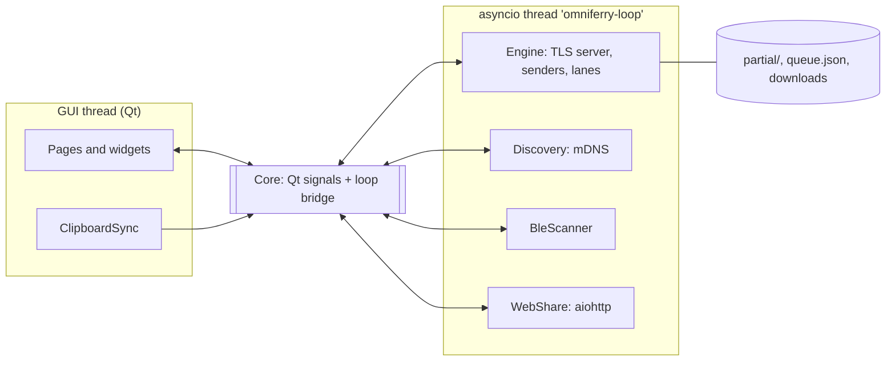

# Architecture (Windows reference implementation)

## Threads

* **GUI thread**: all widgets, `QClipboard`, animations (one shared spring clock matched to the display refresh rate).
* **Loop thread**: every socket. Blocking file I/O goes to executor threads (`asyncio.to_thread`).
* Crossing threads: GUI -> loop with `Core.post()` / `Core.call()`; loop -> GUI only through Qt signals.
  Approval prompts bridge with a `concurrent.futures.Future` that the loop awaits.

## Modules (`windows/src/omniferry/`)

| Module | Responsibility |
|---|---|
| `protocol.py` | framing, handshake, peer model |
| `security.py` | identity, TLS contexts, signing |
| `transfer.py` | `Engine`: sender/receiver, lanes, resume, persistence, cleanup, clipboard push, pairing |
| `discovery.py`, `ble.py` | peer discovery |
| `webserver.py`, `web_ui.py` | browser gateway |
| `clipboard.py` | event-driven clipboard sync |
| `core.py` | wires services to the UI, settings reactions, autostart |
| `config.py` | settings and trust store (atomic JSON writes) |
| `ui/` | theme tokens, spring motion, widgets, cards, pages, tray, popups |

## Data on disk (`%APPDATA%\OmniFerry`)

| Path | Contents |
|---|---|
| `settings.json` | user settings |
| `trusted.json` | paired devices `{id: {name, fp, clip, added}}` |
| `identity-cert.pem`, `identity-key.pem` | this device's identity |
| `queue.json` | unfinished outgoing transfers |
| `partial/` | incoming data (`<peer>-<fid>.part`) and state (`.json`) |
| `logs/omniferry.log` | rotating log (1 MB x 3) |

Received files go to `Downloads\OmniFerry` by default; browser uploads to `Web Uploads\` inside it.

## Network

| Port | Use |
|---|---|
| 48655/tcp | TLS protocol (falls back to a random port if taken; the real port is advertised) |
| 48656/tcp | HTTP web gateway (same fallback) |
| 5353/udp | mDNS (multicast) |

## Testing

`windows/tests/` runs full engines against each other on loopback: multi-lane integrity, 1-to-N with folders,
pause/resume, resume after a receiver restart, fingerprint-mismatch refusal, CRC corruption and resend, pairing,
clipboard trust, orphan cleanup, the web gateway, and a headless UI smoke test (`QT_QPA_PLATFORM=offscreen`).
