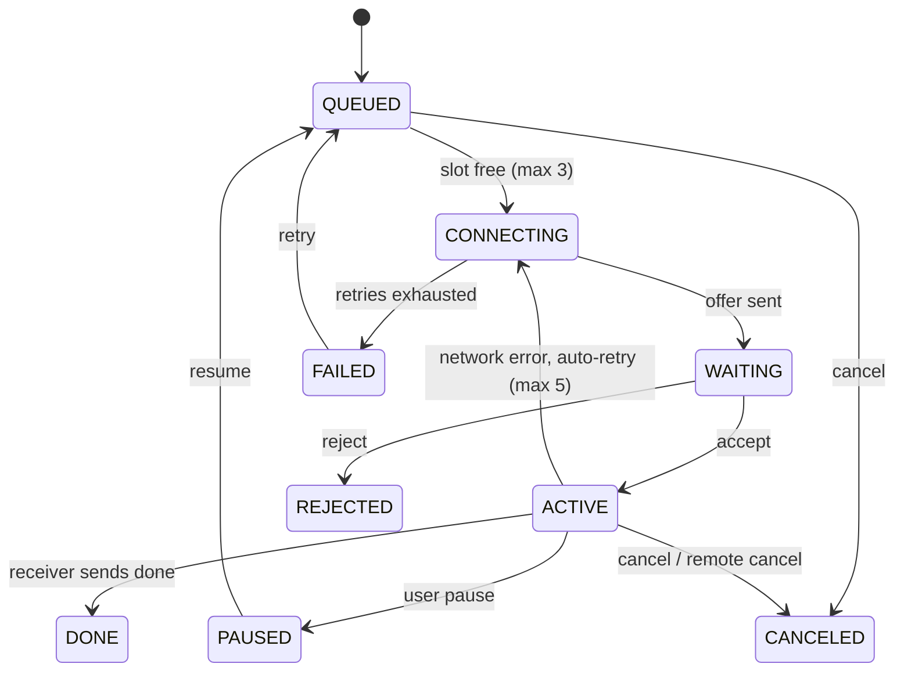

# Transfer engine

## State machine



Receiver side has one extra state: `INTERRUPTED` (partial data kept, waiting for the sender to reconnect).
Only the **sender** can pause, resume or retry; the receiver can cancel.

## Chunks and lanes

* Chunk size: 1 MiB (configurable 256 KiB - 4 MiB) for files of 8 MiB or more; 256 KiB below that.
* Lanes: default 4, maximum 8; a file of at most two chunks uses one lane.
* Each lane is its own TLS connection with a window of 8 unacknowledged chunks. A shared queue hands out chunk indices,
  so fast lanes naturally take more work.
* A failing lane requeues its in-flight chunks and reconnects with backoff while the others continue.
  If every lane dies, the transfer retries as a whole and resumes from `have`.

## 1-to-N

`send_paths(peer_ids, paths)` creates one independent transfer per (peer, file). Peers run concurrently
(subject to the global limit of 3 active transfers). Folders expand into files with relative names.

## Persistence

Receiver state `partial/<peer>-<fid>.json`:

```json
{"key":"...","tid":"...","peer_id":"...","peer_name":"...","name":"folder/a.bin","size":123,
 "chunk":1048576,"fid":"...","mtime":1731234567.0,"ranges":[[0,40],[44,120]],"updated":1731234999.0}
```

Sender queue `queue.json`: a list of `{tid, fid, path, name, size, mtime, chunk, batch, bcount, btotal, lanes, paused, peer}`
where `peer` is the last known peer record (address hints). On start, entries not explicitly paused resume automatically.

State is flushed every 2 s, on pause, and at shutdown. A chunk is recorded only after its bytes are written,
so the persisted ranges are never ahead of the data.

## Cleanup

At startup and hourly: delete partial state older than 7 days (setting), `.part` without state, state without `.part`,
stray `*.tmp`, and `Web Uploads\*.tmp` older than 1 h. Live sessions are never touched.

## Statistics shown in the UI

* **Speed**: bytes delivered over a 2 s sliding window, sampled at 10 Hz; the graph keeps up to 90 points at 0.5 s.
* **Latency**: EWMA (0.8/0.2) of send-to-ACK time per chunk. It includes queueing in the window, so treat it as a trend.
* **Network health** (0-100, floor 5):
  `100 - min(35, max(0, latency_ms - 40) / 8) - min(40, retries * 8) - 12 * (target_lanes - lanes) / target_lanes`.
  Labels: >= 85 Excellent, >= 60 Good, >= 35 Fair, otherwise Poor.
* **Chunk map**: one cell per chunk up to 160; beyond that, cells show the completed fraction of a group of chunks.
